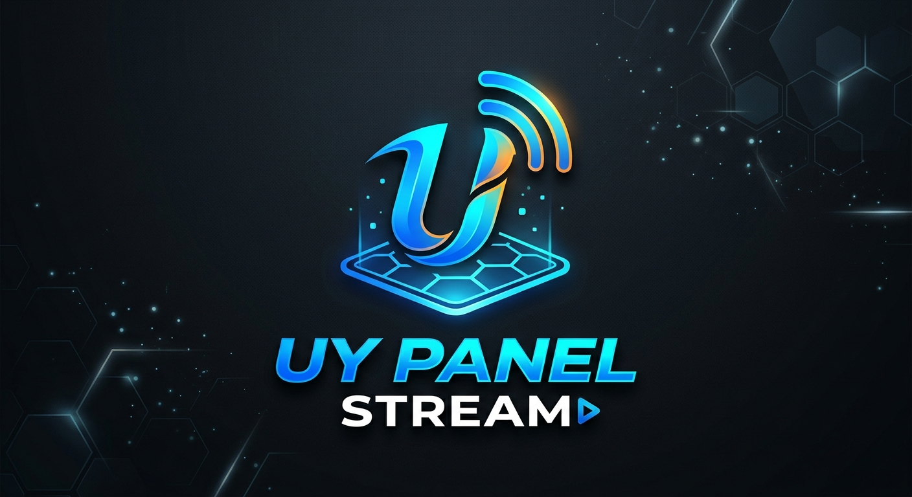

<p align="center">
  
</p>

<h1 align="center">UyPanel IPTV Panel</h1>
<p align="center">
  <b>Open-source, community-driven Xtream Codes panel</b><br>
  Built for modern IPTV workflows – powerful, scalable, and free.
</p>

<p align="center">
  <a href="LICENSE"></a>
  <a href="https://github.com/m4sterinfo/UyPanel/stargazers"></a>
  <a href="https://github.com/m4sterinfo/UyPanel/issues"></a>
</p>

---

# 📑 Table of Contents

<details open>
<summary><strong>📘 Contents</strong></summary>

* 🏁 [Overview](#-overview)
* ⚠️ [Status](#️-status)
* 📚 [Documentation](#-documentation)
* 🧱 [Technology Stack](#-technology-stack)
* 🧩 [Ubuntu Support](#-supported-ubuntu-versions)
* 📥 [Quick Install](#-quick-install)
* 🧰 [Service Management](#-service-management)
* 📂 [Project Structure](#-project-structure)
* 🧮 [Server Requirements & Sizing](#-server-requirements--sizing)
* ⭐ [Features](#-features)
* 🐞 [Known Limitations](#-known-limitations)
* 🤝 [Contributing](#-contributing)
* 📜 [License](#-license)
* ⚖️ [Legal Disclaimer](#-legal-disclaimer)

</details>


---

## 🚀 Overview

**UyPanel** is an open-source IPTV platform based on Xtream Codes.
It enables:

* 📺 Live & VOD streaming
* 🔀 Load balancing
* 📊 Full user/reseller control
* 🎚️ Transcoding & EPG
* 🔐 Hardened security fixes

> ✅ 100% free. No license checks. No server locks.

---

## ⚠️ Status

> **BETA SOFTWARE** — actively developed

---

## 📚 Documentation

* �� **Guía en español**
  [https://m4sterinfo.github.io/UyPanel/#/es-es/](https://m4sterinfo.github.io/UyPanel/#/es-es/)

* �� **English Guide**
  [https://m4sterinfo.github.io/UyPanel/#/en-us/](https://m4sterinfo.github.io/UyPanel/#/en-us/)

---

## 🧱 Technology Stack

| Component | Version    | Description                     |
| --------- | ---------- | ------------------------------- |
| PHP       | 8.1.33        | Backend runtime                 |
| Nginx     | 1.24       | Web server & reverse proxy      |
| FFmpeg    | 8.0, 7.1, 5.1, 4.4, 4.3, 4.0        | Media transcoding & processing  |
| MariaDB   | 11.4      | SQL database engine             |
| KeyDB     | 6.3.4      | Cache & session storage (Redis) |
| yt-dlp    | 2025.07.21 | Audio/Video downloader          |

---

## 🐧 Supported Ubuntu Versions

UyPanel **officially supports** the following Ubuntu LTS and interim releases:

| Ubuntu Version | Codename        | Status                |
| -------------- | --------------- | --------------------- |
| **20.04**      | Focal Fossa     | ⚠️ *Outdated*         |
| **20.10**      | Groovy Gorilla  | ⚠️ *Outdated*         |
| **22.04**      | Jammy Jellyfish | ✅ **Fully Supported** |
| **22.10**      | Kinetic Kudu    | ⚙️ *Compatible*       |
| **24.04**      | Noble Numbat    | ✅ **Fully Supported** |
| **24.10**      | Oracular Oriole | 🧪 *Under Testing*    |

---

### 💡 Recommendations

For new installations, the **strongly recommended** Ubuntu versions are:

* 🟢 **Ubuntu 22.04 LTS**
* 🟢 **Ubuntu 24.04 LTS**

These versions receive full support, active security updates, and provide the stability required for UyPanel.

---

### ⚠️ Important Note About Ubuntu 20.x

Ubuntu 20.04 and 20.10 are **outdated** and no longer receive updates for most essential system packages.
Using these versions is still *possible*, but:

* 🛠️ **Official support is discontinued** — any issues must be resolved by the user.
* 🚫 Bugs caused by outdated dependencies or libraries **will not be addressed** by the UyPanel project.

---

## 📥 Quick Install

> ✅ Ubuntu 22.04 or newer

```bash
# 1. Update system
sudo apt update && sudo apt full-upgrade -y

# 2. Install dependencies
sudo apt install -y python3-pip unzip

# 3. Download latest release
latest_version=$(curl -s https://api.github.com/repos/m4sterinfo/UyPanel/releases/latest | grep '"tag_name":' | cut -d '"' -f 4)
wget "https://github.com/m4sterinfo/UyPanel/releases/download/${latest_version}/UyPanel.zip"

# 4. Unpack and install
unzip UyPanel.zip
sudo python3 install
```

---

## 🧰 Service Management

```bash
sudo systemctl start uypanel     # Start
sudo systemctl stop uypanel      # Stop
sudo systemctl restart uypanel   # Restart
sudo systemctl status uypanel    # Status
sudo /home/uypanel/bin/nginx/sbin/nginx -s reload    # Reload Nginx config
journalctl -u uypanel -f         # Live logs
```

---

## 📂 Project Structure

```text.
├─ docs/        # 📚 Project documentation
├─ lb_configs/  # ⚙️ Configurations for building Load Balancer (LB)
└─ src/         # 💻 Main project code
```

---

## 🧮 Server Requirements & Sizing

### 🔧 Minimum Specs

| Component | Recommendation                |
| --------- | ----------------------------- |
| CPU       | 6+ cores (Xeon/Ryzen)         |
| RAM       | 16–32 GB                      |
| Disk      | SSD/NVMe, 480+ GB             |
| Network   | Dedicated 1 Gbps port         |
| OS        | Ubuntu 22.04+ (clean install) |

---

### 📊 Planning Formulae

* **Bandwidth (Mbps)** = Channels × Bitrate
* **Max Users** = Bandwidth ÷ Stream Bitrate

```text
Example:
HD bitrate = 4 Mbps
1 Gbps = ~940 usable Mbps

→ Max Channels: 940 ÷ 4 = ~235
→ Max Users:    940 ÷ 4 = ~235
```

> ⚠️ 10 users watching the same channel = 10× bandwidth (unless caching or multicast used)

---

### 💻 RAM & CPU Usage

| Resource         | Load per Stream |
| ---------------- | --------------- |
| RAM              | 50–100 MB       |
| CPU (transcoded) | ~1 core         |

---

## ✅ Features

* ✅ No server restrictions
* ✅ EPG importer
* ✅ VOD management
* ✅ User/reseller panel
* ✅ Security patches
* ✅ Clean UI

---

## 🔧 Known Limitations

* ❌ Requires Linux knowledge
* ❌ Community-based support
* ❌ Some bugs in transcoding module (in progress)

---

## 🤝 Contributing

We welcome community help!

* 🛠️ [Contributing Guide](CONTRIBUTING.md)
* 👥 [Contributors List](CONTRIBUTORS.md)

---

## 📝 License

[AGPL v3.0](LICENSE)

---

## ⚠️ Legal Disclaimer

> 🚫 **This software is for educational purposes only.**
> ⚖️ You are solely responsible for how it is used.
> We take no responsibility for misuse or illegal deployments.

---
